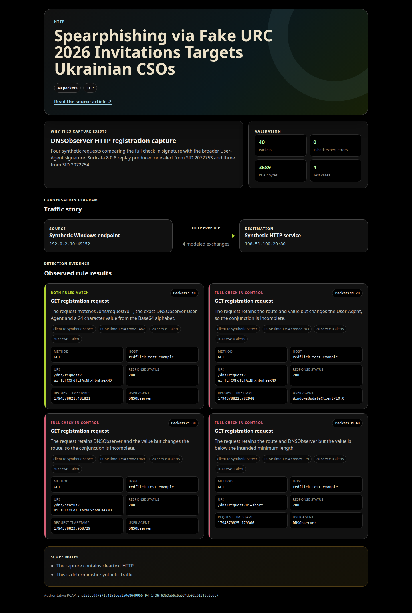

# RedFlick DNSObserver HTTP C2 Check In

This package pairs the two published ET Open DNSObserver rules with a deterministic synthetic HTTP capture and visual explainer. The rules cover the documented check in pattern and a broader User-Agent marker associated with RedFlick reporting.

## Rules

| SID | Detection | Role |
| --- | --- | --- |
| 2072753 | RedFlick DNSObserver CnC Check-In | Method, URI prefix, encoded value shape, and exact User-Agent |
| 2072754 | RedFlick DNSObserver User-Agent Observed | Exact User-Agent with broader request coverage |

Both rules are preserved as published by ET Open, revision 1. Download [redflick-dnsobserver.rules](Suricata/redflick-dnsobserver.rules), or read the [rule walkthrough](Suricata/README.md).

## Contents

- [Suricata](Suricata/): published rules, match conditions, and replay results.
- [pcap](pcap/README.md): capture, packet guide, and visual explainer.

## Replay results

Suricata 8.0.8 passed syntax validation and engine analysis for both rules. Replay of the 40 packet capture returned one alert from SID `2072753` and three alerts from SID `2072754`.

| Request frame | Test case | 2072753 | 2072754 |
| ---: | --- | ---: | ---: |
| 4 | Complete check in pattern | 1 | 1 |
| 14 | Different User-Agent | 0 | 0 |
| 24 | Different request path | 0 | 1 |
| 34 | Short `ui` value | 0 | 1 |

The broader rule intentionally matches the path and value length controls because they retain the exact `DNSObserver` User-Agent. Both rules can alert on the same request.

Replay included `192.0.2.10` in `$HOME_NET` and `198.51.100.20` in `$EXTERNAL_NET`. These documentation addresses must be mapped to the rule variables when testing this fixture.

## Visual explainer

The [browser explainer](pcap/redflick-explainer.xml) shows both published rules and the observed results for each request. The original capture bytes are preserved.

## Interpretation

The full rule identifies the documented request shape. The broader rule identifies the exact User-Agent, including requests with different methods or paths. Investigate the source endpoint and related activity to determine the significance of an alert. Both rules require visible HTTP, either cleartext or after TLS decryption.

[SHA256SUMS](SHA256SUMS) records the package hashes. [validation.json](Suricata/validation.json) records the replay results.

## References

- [Digital Security Lab Ukraine campaign analysis](https://dslua.org/publications/spearphishing-via-fake-urc-2026-invitations-targets-ukrainian-csos/)
- [ET rule submission and published SID announcement](https://community.emergingthreats.net/t/sig-malware-redflick-dnsobserver-http-c2-check-in/3527/4)
- [ET Open malware rules](https://rules.emergingthreats.net/open/suricata-7.0.3/rules/emerging-malware.rules)
