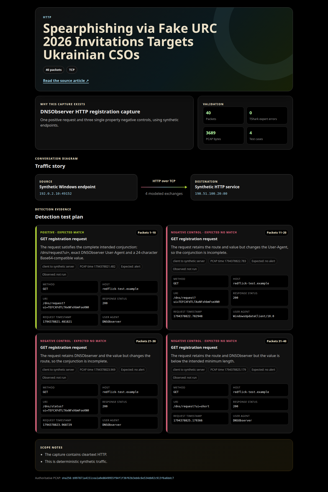

# RedFlick DNSObserver HTTP C2 Check In

This package pairs a Suricata rule with a deterministic synthetic PCAP for the RedFlick DNSObserver HTTP registration behavior described in the referenced research.

The capture contains one request that satisfies the complete rule and three single property negative controls. The controls separately change the User-Agent, request path, and encoded value length so each major condition can be reviewed independently.

## Directory layout

- [`Suricata/`](Suricata/): detection description, rule code block, and directly loadable rule file
- [`pcap/`](pcap/): synthetic packet capture, browser explainer, and embedded explainer image

## Capture test plan

| Packets | Role | Expected result | Changed condition |
| ---: | --- | --- | --- |
| 1 to 10 | Intended positive | Alert | None; complete conjunction |
| 11 to 20 | Negative control | No alert | User-Agent changed |
| 21 to 30 | Negative control | No alert | Request path changed |
| 31 to 40 | Negative control | No alert | `ui` value is shorter than 24 characters |

The PCAP contains 40 packets of cleartext HTTP between synthetic documentation addresses. Packet structure was checked with TShark and reported zero expert warnings or errors. Suricata replay remains pending, so the table records expected rather than observed rule outcomes.

## Visual explainer

The browser renderable source is available as [`redflick-explainer.xml`](pcap/redflick-explainer.xml).

## Integrity

| File | SHA-256 |
| --- | --- |
| [`redflick-dnsobserver-http.pcap`](pcap/redflick-dnsobserver-http.pcap) | `b997871a4151cea1a0e8649955f94f1f36f63b3eb6c6e534db02c913f6a6bdc7` |
| [`redflick-explainer.xml`](pcap/redflick-explainer.xml) | `a52c24cc11da7c1fa3b3050d531fa0aaecb5dc67c44e8e9ba4c001bab851659c` |
| [`redflick-explainer.png`](pcap/redflick-explainer.png) | `98c33426f84328273378c1d3cb1c71d929bfbec87a81a378611194004512e0d4` |

## Evidence boundary

The rule identifies the modeled HTTP registration marker. An alert establishes that the network request matched the documented conditions; it does not by itself prove host compromise or successful command and control. The rule requires visibility into cleartext HTTP.

## Reference

- [Spearphishing via Fake URC 2026 Invitations Targets Ukrainian CSOs](https://dslua.org/publications/spearphishing-via-fake-urc-2026-invitations-targets-ukrainian-csos/)
