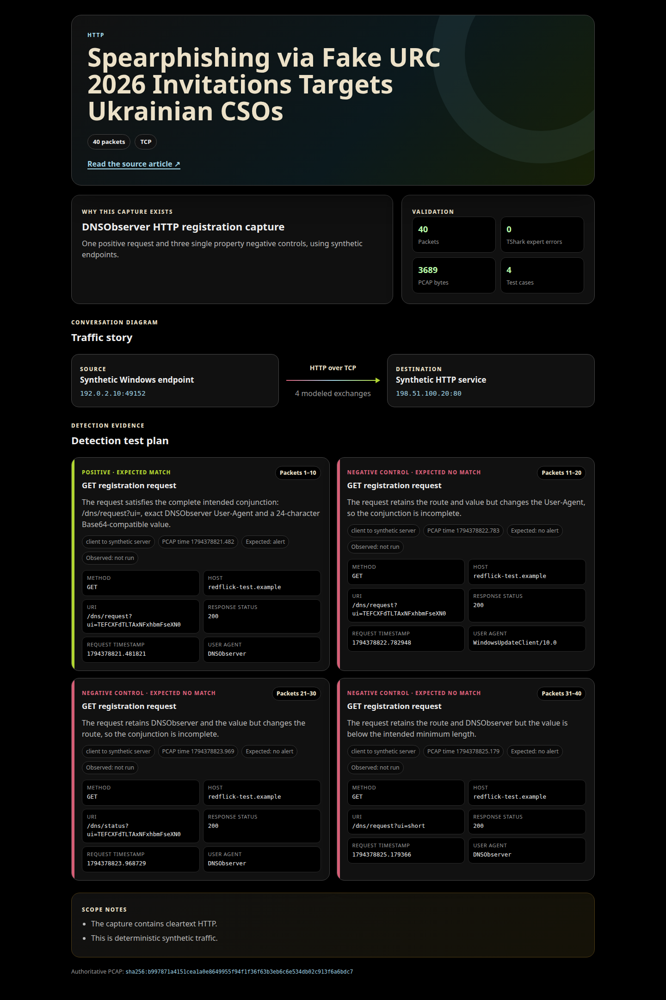

# RedFlick DNSObserver HTTP C2 Check In

This directory contains a Suricata rule and a deterministic synthetic PCAP for the RedFlick DNSObserver HTTP registration behavior described in the referenced research.

The capture contains one request that satisfies the complete rule and three single property negative controls. The controls separately change the User-Agent, request path, and encoded value length so each major condition can be reviewed independently.

## Detection summary

The rule inspects established HTTP requests sent to a server and requires all of the following:

- the HTTP method is exactly `GET`
- the normalized URI starts with `/dns/request?ui=`
- the `ui` value begins with 24 to 256 Base64 compatible characters
- the User-Agent is exactly `DNSObserver`

This identifies the modeled HTTP registration marker. An alert establishes that the network request matched these conditions; it does not by itself prove host compromise or successful command and control.

## Suricata rule

```suricata
alert http any any -> any any (msg:"LOCAL MALWARE RedFlick DNSObserver HTTP C2 Check-in"; flow:established,to_server; http.method; content:"GET"; startswith; endswith; http.uri; content:"/dns/request?ui="; startswith; pcre:"/^\/dns\/request\?ui=[A-Za-z0-9+\x2f=]{24,256}(?:&|$)/"; http.user_agent; content:"DNSObserver"; startswith; endswith; fast_pattern; reference:url,dslua.org/publications/spearphishing-via-fake-urc-2026-invitations-targets-ukrainian-csos/; classtype:trojan-activity; sid:9901201; rev:1;)
```

A directly loadable copy is available in [`redflick-dnsobserver.rules`](redflick-dnsobserver.rules).

## Capture test plan

| Packets | Role | Expected result | Changed condition |
| ---: | --- | --- | --- |
| 1 to 10 | Intended positive | Alert | None; complete conjunction |
| 11 to 20 | Negative control | No alert | User-Agent changed |
| 21 to 30 | Negative control | No alert | Request path changed |
| 31 to 40 | Negative control | No alert | `ui` value is shorter than 24 characters |

The PCAP contains 40 packets of cleartext HTTP between synthetic documentation addresses. Packet structure was checked with TShark and reported zero expert errors. Suricata replay remains pending, so the table records expected rather than observed rule outcomes.

## Files

- [`redflick-dnsobserver.rules`](redflick-dnsobserver.rules): directly loadable one line Suricata rule
- [`redflick-dnsobserver-http.pcap`](redflick-dnsobserver-http.pcap): 40 packet synthetic HTTP test capture
- [`redflick-explainer.xml`](redflick-explainer.xml): browser renderable explainer source
- [`redflick-explainer.png`](redflick-explainer.png): full visual rendering of the explainer

## Visual explainer

[](redflick-explainer.png)

## Integrity

| File | SHA-256 |
| --- | --- |
| `redflick-dnsobserver-http.pcap` | `b997871a4151cea1a0e8649955f94f1f36f63b3eb6c6e534db02c913f6a6bdc7` |
| `redflick-explainer.xml` | `a52c24cc11da7c1fa3b3050d531fa0aaecb5dc67c44e8e9ba4c001bab851659c` |
| `redflick-explainer.png` | `98c33426f84328273378c1d3cb1c71d929bfbec87a81a378611194004512e0d4` |

## Reference

- [Spearphishing via Fake URC 2026 Invitations Targets Ukrainian CSOs](https://dslua.org/publications/spearphishing-via-fake-urc-2026-invitations-targets-ukrainian-csos/)
